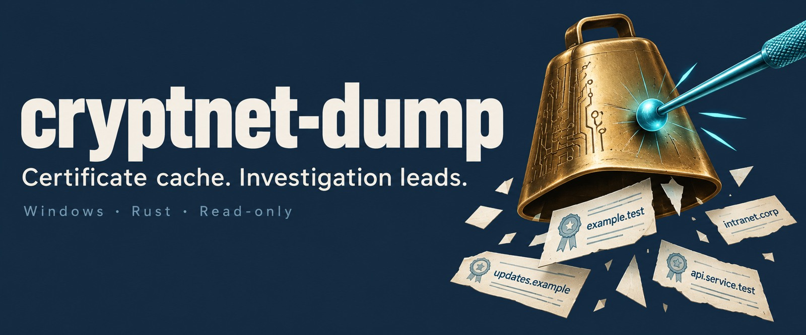
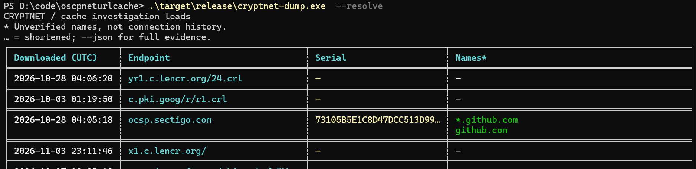

# cryptnet-dump



**Turn Windows' certificate cache into leads for an investigation.**

Recover cached certificate-validation URLs and candidate hostnames to help triage
malware callbacks and investigate past activity. One standalone Rust executable:
**no Python, no installation, read-only, offline by default.**

[Read the forensic field guide](https://truekonrads.github.io/ocspcryptneturlcache/)
for the artefact, cache format, WinINet/WinHTTP behavior, and interpretation limits.
The static site lives in `docs/`; publish it with GitHub Pages from `main` → `/docs`
(no build step required).

## See it in action

Read the current user's cache and look up certificate names:

```powershell
.\cryptnet-dump.exe --resolve
```



Here, a cached check against `ocsp.sectigo.com` resolves to certificate names
`*.github.com` and `github.com`: a useful lead suggesting **GitHub was accessed**,
even without browser history. This is the value of resolving certificate serials:
an otherwise opaque revocation endpoint becomes a recognizable investigation pivot.
Confirm access with other evidence: these are serial-only, unverified candidates,
not proof of a GitHub visit, and the timestamp records cache activity, not a visit time.

Long values are shortened with `…`; up to two names are shown, with a count of
additional names. `--json` keeps **all fields and full values** as JSON Lines,
including source paths, issuer hashes, content sizes, ETags, and warnings.
Use these leads to pivot on certificates and domains;
**they are not proof of a connection to every listed name or attribution to a process.**

## Usage

```powershell
# Dump the current user's cache without any network requests
.\cryptnet-dump.exe

# Save full evidence for scripts and further analysis
.\cryptnet-dump.exe --ocsp-only --resolve --json --output leads.jsonl

# Include other user and service profiles (run elevated for protected caches)
.\cryptnet-dump.exe --all-users --ocsp-only --resolve

# Examine a collected cache instead of the live machine
.\cryptnet-dump.exe --path D:\Evidence\CryptnetUrlCache --json --output evidence.jsonl
```

- Table rows and JSON records stream immediately, not after all lookups finish.
  `--output` saves the selected format and never overwrites an existing file.
  Colors are disabled in files/pipes; set `NO_COLOR=1` for a plain terminal table.
- Resolution while scanning cache directories shows an animated progress bar on
  stderr. Use `--no-progress` to hide it; redirecting stderr hides it automatically.
- `--resolve` sends serials to **ctlogs.dev first**, with **crt.sh as fallback**.
  For faster resolution on larger collections, set **`CTLOG_API_KEY`** in the
  resolver machine's environment (see below). No key is required for anonymous use.
- Run `--help` for all options. Records that succeed are kept if another fails;
  check stderr and the exit code for incomplete collection.

## Collect on the target, resolve on your forensic machine

**On the target Windows machine**, collect full JSON Lines without network lookups:

```powershell
.\cryptnet-dump.exe --json --output evidence.jsonl
```

Add `--all-users` from an elevated shell to include other user/service profiles.
Transfer `evidence.jsonl` to your forensic machine; the original cache directories
do not need to be present there. Preserve the original evidence file unchanged.

**On the forensic machine**, feed that JSON back in for resolution:

```powershell
.\cryptnet-dump.exe --input evidence.jsonl --resolve
# Save full enriched evidence instead of the table
.\cryptnet-dump.exe --input evidence.jsonl --resolve --json --output resolved.jsonl
```

`--input` reads JSON Lines produced by `--json`, never opens the recorded source
paths, and cannot be combined with `--path` or `--all-users`. Without `--resolve`,
it can also display previously enriched JSON offline. Resolution replaces existing
candidate names with cached or newly queried results and retains original collection warnings.

### Optional ctlogs.dev API key

Obtain a key from [ctlogs.dev](https://account.ctlogs.dev/) and make it available
as the **`CTLOG_API_KEY` environment variable** before running `--resolve`.


A key avoids the anonymous shared-capacity pool and can improve throughput;
limits depend on the plan, so it does not guarantee faster responses. Anonymous
use allows 100 requests/hour; a free key also has a 100 requests/hour limit plus
a monthly allowance. Each search page and certificate-detail fetch is a request.
The resolver caps each serial search at ten pages, even with a key, and falls
back to crt.sh on errors or no names.

### Persistent serial cache

`--resolve` reuses previously resolved serials **across runs, without expiry**.
Only non-empty name matches are saved; empty results are kept in memory for the
current run, and errors are never cached. Certificate expiry does not remove
historical matches. Names remain unverified serial-only candidates.

The default cache directory is printed on stderr:

- **Windows:** `%LOCALAPPDATA%\ocspcryptneturlcache\resolver.cache`
  (falls back to `%USERPROFILE%\AppData\Local` if `LOCALAPPDATA` is unset).
- **Linux/other non-Windows builds:** `$XDG_CACHE_HOME/ocspcryptneturlcache/resolver.cache`
  or `~/.cache/ocspcryptneturlcache/resolver.cache` when unset.

This is a **directory**, with an atomically written JSON file per normalized
serial, so concurrent runs do not overwrite unrelated cached serials. It contains
serials and candidate names, not API keys or source cache files; treat it as
sensitive investigation data. Original Windows cache/evidence files stay unchanged.

Use `--resolver-cache D:\Analysis\resolver.cache` with `--resolve` to choose a
different directory, or `--no-resolver-cache` to bypass disk reads and writes and
query CT again. To refresh a stored match, delete its cache file (or the cache
directory) before resolving again. Cache read/write problems produce warnings
but do not discard successful online results. Without `--resolve`, no resolver
cache is read or created. Save `resolved.jsonl` and reopen it with
`--input resolved.jsonl` without `--resolve` to review saved enrichment offline.

## Get the executable

Target: **64-bit Windows 10/11 and Server 2016+**; live-tested on Windows 11 x64.
No Python, OpenSSL DLLs, or VC++ runtime installation is needed on the target.

**[Download the latest release](https://github.com/truekonrads/ocspcryptneturlcache/releases/latest)**
and extract the ZIP for **x64** (most PCs) or **ARM64** (Windows on ARM).
Each ZIP includes the executable, documentation, and a SHA-256 checksum;
the release also includes checksums for the ZIPs themselves.

Build with stable Rust (MSVC) and Visual Studio C++ Build Tools:

```powershell
cargo build --release --locked
```

Copy `target\release\cryptnet-dump.exe` to the machine being examined. The
[release workflow](https://github.com/truekonrads/ocspcryptneturlcache/blob/main/.github/workflows/build.yml)
cross-compiles x64 and ARM64 on Linux, validates them on native Windows runners,
and publishes ZIPs on `v*` tags; ARM64 execution remains untested locally.
See [Linux build instructions](docs/how-it-works.md#cross-compiling-windows-releases-on-linux)
to produce the same executables without Visual Studio.

## How it works

Windows caches certificate-revocation checks in `CryptnetUrlCache`. The tool reads
that cache directly, extracts certificate serials and issuer hashes from OCSP
URLs and response bodies, and optionally searches Certificate Transparency data
for certificate names. Cache timestamps describe validation activity, not
connection times; lookup names are candidates, not issuer-verified matches.
Read [how it works](docs/how-it-works.md) for the technical details, limitations,
and investigation workflow. The original Python proof of concept is archived in
[`old/`](https://github.com/truekonrads/ocspcryptneturlcache/tree/main/old).
